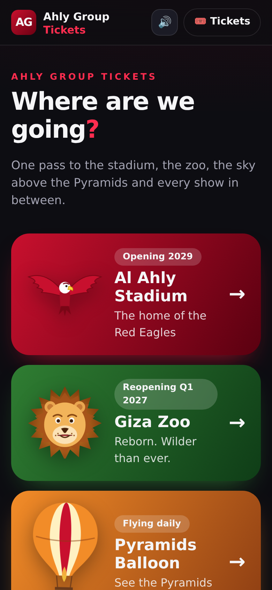
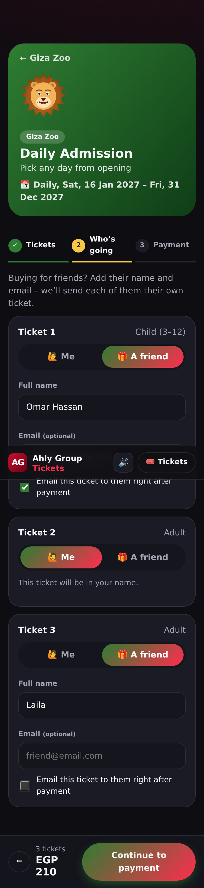
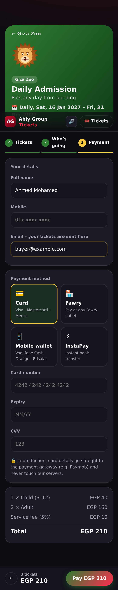
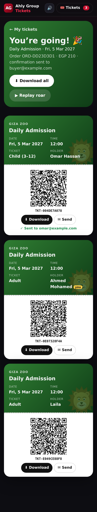
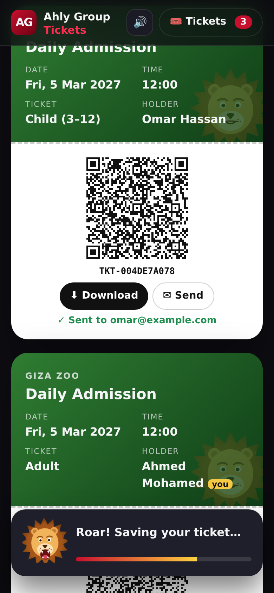
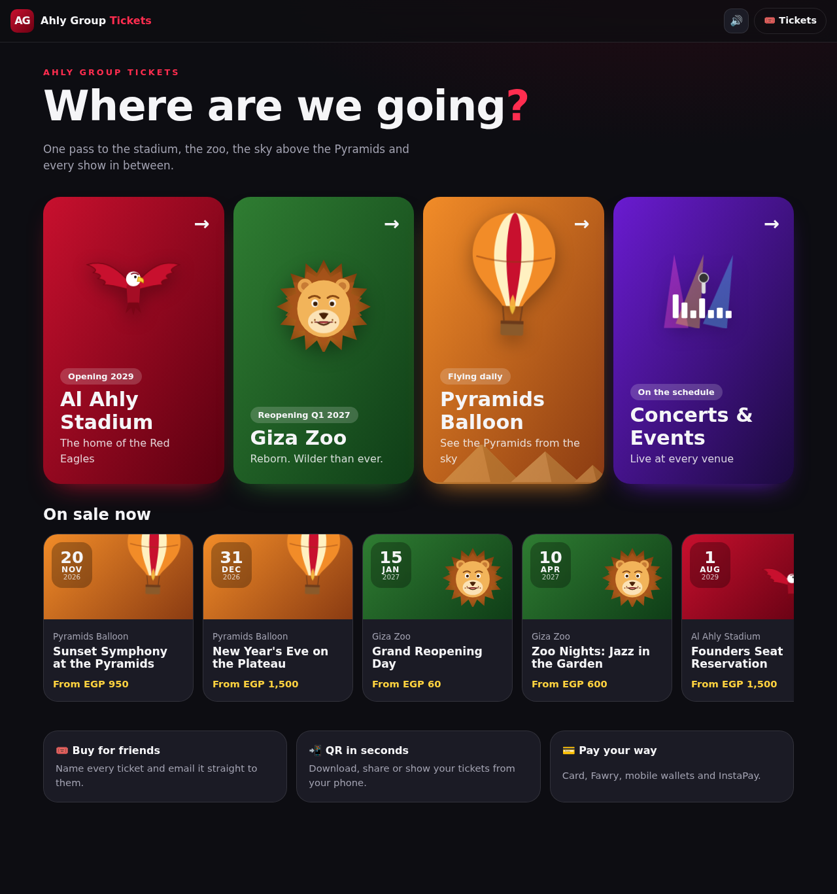

# Ahly Group Tickets 🎟️

One ticketing hub for the group's destinations:

| | Destination | Status | Purchase animation |
|---|---|---|---|
| 🦅 | **Al Ahly Stadium** | Opening 2029 – Founders Seat pre-sale + waitlists | Red eagle swoops in, flags wave, crowd cheers + drums |
| 🦁 | **Giza Zoo** | Reopening Q1 2027 – opening day, daily admission, night safari | Lion **roars** (jaw drop, shockwaves, screen shake, synthesized roar) |
| 🎈 | **Pyramids Tethered Balloon** | Flying daily – sunrise / day / private sunset slots | Balloon lifts off over the Pyramids with burner whoosh |
| 🎤 | **Concerts & Events** | Shows hosted at any of the venues | Stage lights, equalizer, flying notes + chord |

Inspired by Tazkarti / Ticketmarche: event schedule per venue, ticket categories, Fan ID for stadium
tickets, local payment methods (card, Fawry, mobile wallets, InstaPay).

## Features

- **Home page with 4 big destination bars** (stacked on phones, 4 columns on desktop).
- **Venue pages** with the schedule; coming-soon events offer a **waitlist**.
- **3-step checkout**: Tickets (date, time slot, categories) → **Who's going** (each ticket is *Me* or *A friend*,
  with the friend's name/email and "email it to them right after payment") → Payment.
- **Themed celebration** after purchase, and a mini animation + sound while **downloading** a ticket.
- **Tickets with QR codes**: download as PNG, **send to a friend's email** at any time, shareable ticket link.
- Tickets are **HMAC-signed** by the server so they can't be forged; `GET /api/tickets/:code` verifies at the gate.
- Prices are always recomputed on the server – the client can't change them.
- Installable PWA, works on phones, sound on/off toggle, respects *reduced motion*.

## Run it

```bash
npm install
cp .env.example .env        # optional
npm run dev                 # web on http://localhost:5173, API on :8787
npm test                    # server tests
```

Production (one Node process serving API + web app):

```bash
npm start                   # builds, then serves on $PORT
```

Without SMTP settings the API runs in **demo mail mode** (emails are logged). Without the API at all
(e.g. GitHub Pages) the web app still works end-to-end in **demo mode** – orders are created in the browser
and "Send" opens the user's mail app with the ticket link.

## Deploy the demo to GitHub Pages

`.github/workflows/pages.yml` builds and publishes on every push to `main`.
Enable it in **Settings → Pages → Source: GitHub Actions**. To connect a real API, set the repository
variable `VITE_API_URL`.

## Project layout

```
index.html               app shell
src/data/venues.js       venues, events, ticket categories, prices (shared by web + API)
src/views/               home, venue, booking (3 steps), tickets/order pages
src/animations.js        lion / eagle / balloon / concert celebrations + mini download animation
src/sound.js             all sound effects, synthesized with Web Audio (no audio files)
src/art.js               SVG illustrations
src/ticketImage.js       renders a ticket (with QR) to a PNG for download
server/                  Express API: orders, signed tickets, email delivery, waitlist
test/                    node:test tests for the order rules
```

## Before going live

- Plug a real payment gateway (e.g. Paymob, Fawry) into `createOrder` in `server/orders.js`.
- Replace the JSON-file storage with a database; add user accounts / OTP login.
- Set `TICKET_SECRET`, SMTP credentials and `PUBLIC_URL`.
- Add Arabic (RTL) translations – the Cairo font already supports Arabic.
- Real seat maps and capacity limits per date/slot for the stadium and balloon.

## Design

| Home | Lion roar (Giza Zoo) | Eagle (Al Ahly) | Balloon (Pyramids) |
|---|---|---|---|
|  |  |  |  |

| Who's going (buy for friends) | Payment | Tickets | Download animation |
|---|---|---|---|
|  |  |  |  |

Desktop home: 
